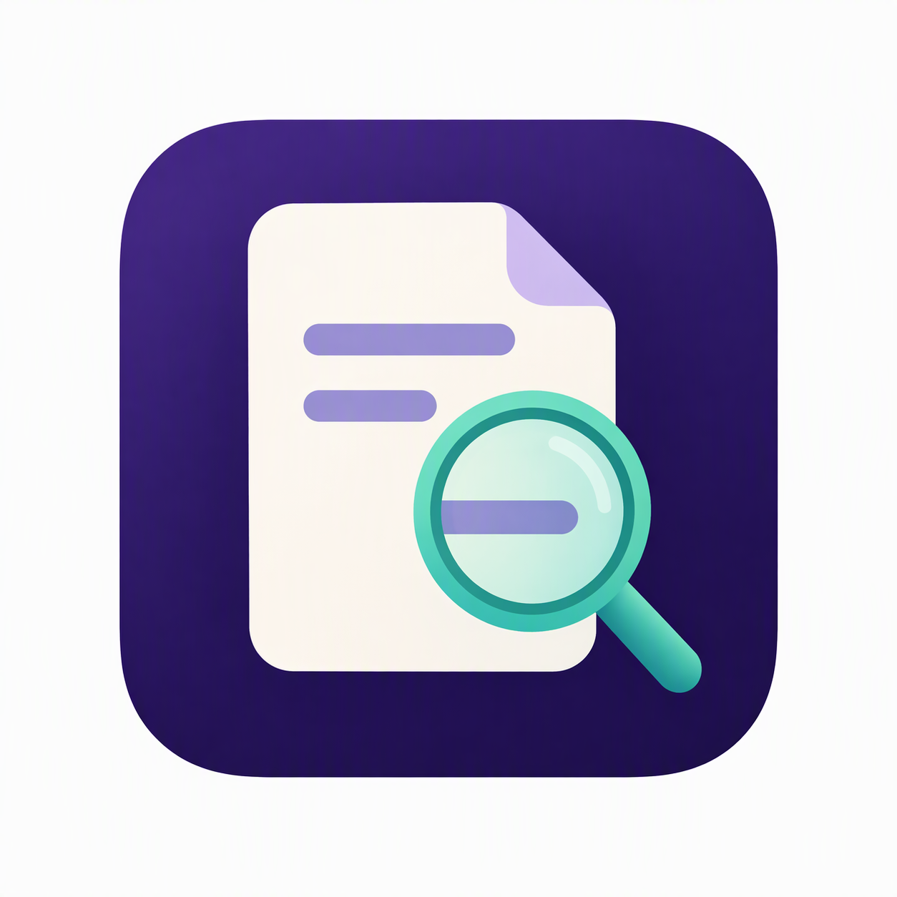

  

# Paper Lens · 论镜

**论镜（Paper Lens）** 是一款 Obsidian 论文阅读插件，支持阅读、批注英文论文，并在同一标签页对照简体中文译文。

- 原文与译文双栏阅读，支持同步或独立滚动、缩放和页码跳转。
- 荧光笔高亮与文字批注，可分别保存到原文和译文 PDF。
- 使用自定义 OpenAI 兼容模型 API 翻译全文，生成同目录中文 PDF。
- 可配合独立的 [Claudian](https://github.com/YishenTu/claudian) 插件，基于当前论文和选区进行问答。

## 使用要求

- macOS 桌面版 Obsidian **1.12.7 或更新版本**，论文存放在本地 Vault。
- PDF 需包含可见、可提取的文字，暂不支持扫描件。
- 全文翻译需要 OpenAI 兼容模型服务的 API 地址、API Key 和模型 ID。
- 首次翻译需联网下载 Python 运行环境、依赖、识别模型和字体，请预留数百 MB 缓存空间。

## 安装

1. 从 [GitHub Releases](https://github.com/jejunewu/obsidian-paper-lens/releases/latest) 下载 `paper-lens-<版本号>.zip`。
2. 在 Vault 中创建 `.obsidian/plugins/paper-lens/`，将压缩包内的 `main.js`、`manifest.json`、`styles.css` 和完整的 `resources/` 解压到该目录。
3. 在 Obsidian 的“设置 → 第三方插件”中启用 Paper Lens。

更新时替换上述文件和资源目录，再关闭并重新启用插件。

## 打开与阅读

点击侧边栏的“Paper Lens：打开论文”、执行命令“打开论文 PDF”，或在 PDF 文件右键菜单中选择“使用 Paper Lens 打开”。

原文栏始终显示，点击工具栏的“打开译文 / 关闭译文”展开或收起对照栏，拖动中间分隔线可调整两栏宽度。

- **缩放**：支持 −/+、25%–400% 百分比输入、“适合宽度”、触控板捏合和 Ctrl + 滚轮；两栏共享缩放比例。
- **翻页**：支持连续滚动、单页阅读、上一页、下一页和页码跳转。
- **滚动模式**：展开译文后可选择“同步滚动 / 独立滚动”。同步时两栏保持相同页码和页内相对位置；独立时翻页按钮及页码输入作用于最后操作的一栏。重新开启同步时对齐到当前操作栏。

工作区会保存滚动模式、两栏阅读位置和缩放比例。

## 批注与保存

原文和已完成并保存的译文均支持批注。先点击要编辑的一栏，状态行会显示“当前编辑：原文 / 译文”。

| 工具 | 使用方式 |
| --- | --- |
| 选择 / 拖动 | 选择文字及批注，或拖动平移页面。 |
| 荧光笔 | 点击进入连续标注模式，选中文字并松开即可高亮；已有选区时点击可直接高亮。旁边的色块可选颜色，选择模式下选中已有高亮可修改颜色。再次点击、切换工具或在阅读区域按 Esc 退出。 |
| 插入文本 | 选择文字颜色和字号（6–96 pt），点击工具后在 PDF 中放置透明文字框。选中后可拖动，右下角手柄可调整大小，双击编辑内容。 |
| 删除 / 撤销 | 删除选中的 Paper Lens 批注，或撤销本次保存前的批注操作。 |
| 保存 | 将两栏的待保存批注分别写入对应 PDF，保留其他阅读器的批注。 |

每个 PDF 首次保存时会保留 `文件.pdf.paper-lens.bak` 备份。文件被外部修改时，插件会拒绝覆盖；关闭含未保存批注的文档时，可选择保存、放弃或取消关闭。两栏各自保留撤销记录和恢复草稿，收起译文栏后待保存批注仍会保留。

中文文字批注会嵌入约 16 MB 的字体，后续保存复用该字体。文字超出框时，请扩大文字框或缩短内容。

## 配置与全文翻译

打开“Obsidian → 设置 → Paper Lens”：

| 配置 | 说明 |
| --- | --- |
| 模型 API 地址 | 填写服务提供的地址，如 `https://api.example.com/v1`、带自定义前缀的地址或完整的 `/chat/completions` 地址。 |
| API Key | 保存在 Obsidian 原生密钥存储中；无认证的本地服务可填任意非空值。 |
| 翻译模型 ID | 填写服务支持的模型 ID，文本模型即可。 |
| 推理强度 | 默认不发送 `reasoning_effort`，仅在服务支持时选择。 |
| 请求超时 | 单次请求 10–600 秒，默认 60 秒；长段落可适当调高。 |
| 翻译请求并发 | 1–4，默认 4；同时作为每秒请求上限，遇到服务限流时可降低。 |
| 自动提取术语表 | 默认关闭；开启可改善术语一致性，会增加 API 请求和耗时。 |
| 工作目录 | 默认 `~/Library/Application Support/Paper Lens/`，存放运行环境和翻译任务文件。 |

1. 填写 API 地址、API Key 和模型 ID，可点击“测试连接”确认配置；该操作会消耗少量 API 额度。
2. 打开论文，点击工具栏的“全文翻译”。首次运行会自动准备本地翻译环境。
3. 等待版面识别、段落翻译和排版完成，插件会加载译文并保存中文 PDF。

工具栏可切换模型或填写自定义模型 ID。“刷新模型”需要服务支持模型目录接口；服务没有模型目录时，仍可直接填写 ID。

### 译文保存与恢复

译文保存在原 PDF 同目录，命名为 `文件.zh-CN.pdf`；重名时追加编号，避免覆盖已有文件。

在同一 Vault 内移动或重命名原文、父文件夹后，插件可找回匹配的已完成任务并重新关联译文。原文或译文保存 Paper Lens 批注后，重启仍可恢复译文及已保存批注，无需重新翻译。原文正文或模型配置改变时，需要重新翻译。

如果译文文件缺失，插件可从有效的已完成任务中恢复译文正文；原译文中的批注需要从备份找回。

点击“取消翻译”可终止任务。失败或取消后，点击“全文翻译”重新处理全文；当前不支持段落级断点续译。

### 配合 Claudian 问答

安装并启用 Claudian，在 Paper Lens 原文的**选择模式**中选中 PDF 片段，然后在 Claudian 中提问。Claudian 可读取当前 PDF 文件上下文和选区；问答模型、权限和会话由 Claudian 管理。

荧光笔模式会清除已完成高亮的文本选区，需要问答时请切回选择模式并重新选中。

## 数据与适用范围

全文翻译使用 **PDFMathTranslate-next 2.9.0 / BabelDOC 0.6.2** 在本地解析和排版 PDF，段落文本发送到你配置的模型服务，API 费用由服务商收取。API Key 不写入插件配置或翻译任务文件。

公式、图表及分页由翻译框架尽量保留，密集算法、小字号、复杂公式和参考文献仍可能出现排版问题。检测到段落翻译失败时，插件不会自动保存不完整译文；译文的语义准确性和排版仍需自行核对。

## 反馈与开源组件

使用问题和功能建议请提交到 [GitHub Issues](https://github.com/jejunewu/obsidian-paper-lens/issues)，版本变化见 [更新记录](CHANGELOG.md)。反馈时请注明插件版本、Obsidian 版本和问题现象，避免附带 API Key 或敏感论文内容。

- [PDFMathTranslate-next](https://github.com/PDFMathTranslate/PDFMathTranslate-next) 和 [BabelDOC](https://github.com/funstory-ai/BabelDOC) 使用 AGPL-3.0。
- [PyMuPDF](https://github.com/pymupdf/PyMuPDF) 使用 AGPL 或商业许可。
- 中文批注字体 Noto Sans CJK 使用 [SIL Open Font License](assets/OFL.txt)。

安装包包含翻译框架许可文本和来源说明，Python 依赖、识别模型及下载字体各自保留其许可。分发或修改相关组件时请遵守对应许可，详见 [运行时许可说明](runtime/pdfmath/NOTICE.md)。
